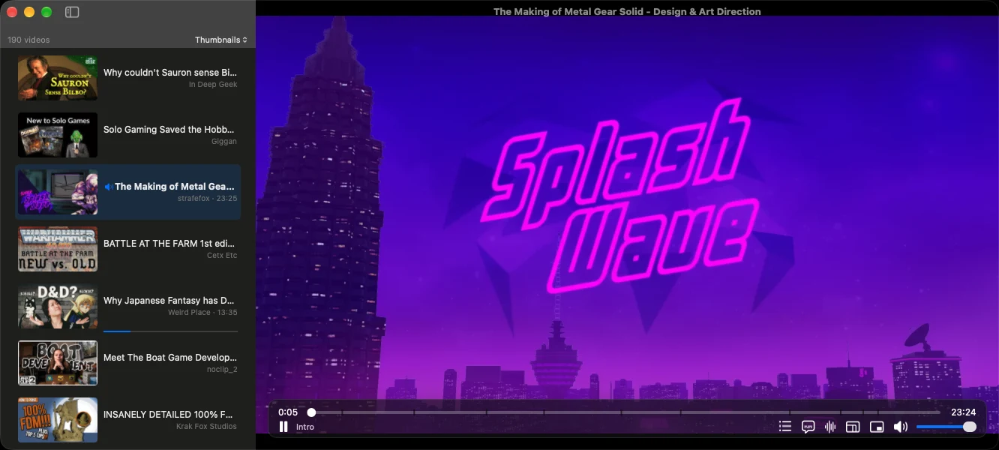
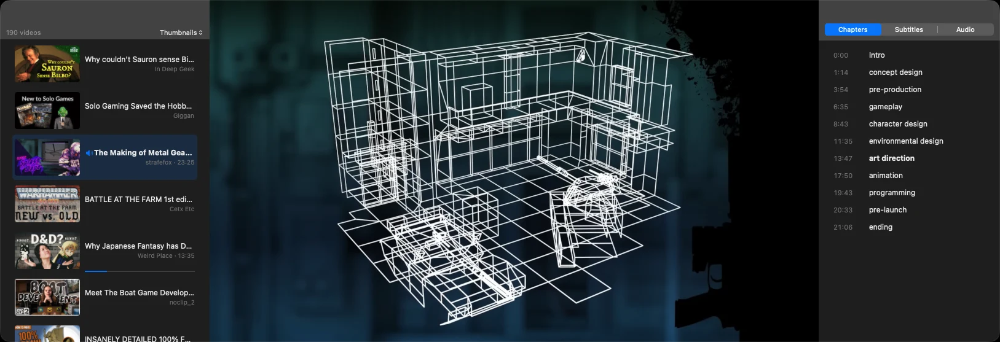
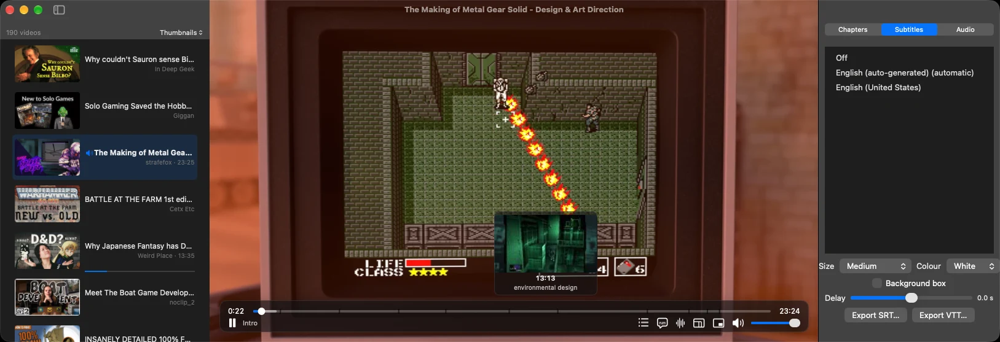

<p align="center">
  
</p>

<h1 align="center">Cue</h1>

**Your YouTube watch-later queue, in a native macOS player.**

Cue keeps a queue of the YouTube videos you mean to watch and plays them in a native Mac player. It resolves the
video streams itself and hands them to libmpv, which decodes them on your Mac's hardware decoder. There is no
embedded YouTube player, and no ads.

<p align="center">
  
</p>

**[Download the latest release](https://github.com/neverbot/cue/releases/latest)** · [Build from source](building.md)

## Requirements

- macOS 14 Sonoma or later, on Apple silicon.
- To build it yourself: Apple Command Line Tools with Swift 6 (`xcode-select --install`). Xcode is not required.

## Install

Download `Cue-<version>.dmg` from the [releases page](https://github.com/neverbot/cue/releases), open it and drag
Cue to Applications. `SHA256SUMS` in the same release holds the checksums of both archives.

Cue is signed ad-hoc, so macOS quarantines it and blocks the first launch with a message about not being able to
verify the developer. Clear the quarantine:

```sh
xattr -dr com.apple.quarantine /Applications/Cue.app
```

Or open **System Settings ▸ Privacy & Security** and press **Open Anyway**.

A build you make yourself is never quarantined.

## Features

- **Native stream resolution.** Cue asks YouTube for the streams and plays them with libmpv.
- **Hardware decoding.** AV1, H.264 or VP9 in silicon, up to 1080p. Software decoding covers VP9 up to 1080p and
  AV1 up to 720p for videos that offer nothing hardware-friendly.
- **AAC audio**, or Opus for videos that carry no AAC.
- **A queue sidebar** with three row shapes: title and channel, thumbnails, or one line per video.
- **Adding videos** by paste, drag and drop, or `cue://add` links, with the option to play one as it arrives.
- **Import and export** as a URL list, JSON or Takeout-style CSV.
- **Resume positions**, watched state and a count of what is left.
- **On-screen controls** with chapter marks on the seek bar and thumbnail previews while you scrub.
- **An inspector** with chapters, subtitles and audio languages.
- **Subtitles** with size, colour, timing offset and SRT or WebVTT export.
- **Audio language switching** that does not reload the stream.
- **A mini player**: a small window that stays above other apps.
- **A disk-backed stream cache**, so a paused video keeps buffering: about twenty minutes of 1080p in
  `~/Library/Caches/Cue/stream-cache`, deleted as it is written.
- **A bookmarklet** that sends the YouTube page you are on to Cue.
- **`cue-resolve`**, a command-line tool that prints the streams the extraction core picks.

Cue ships as one self-contained app. It downloads nothing at first launch and bundles no Python or JavaScript
runtime; the JavaScript YouTube requires runs in macOS's own JavaScriptCore.

## Privacy

Cue contacts two hosts: `www.youtube.com` and `i.ytimg.com`. No analytics, no crash reporting, no account, no sync,
no third-party metadata or segment service. Your queue lives on your Mac, and nothing about what you watch leaves it.

## Keyboard

| Key | Action |
|---|---|
| Space | Play or pause |
| ← / → | Seek 5 seconds |
| ↑ / ↓ | Volume |
| F / ⌃⌘F | Full screen |
| M | Mute |
| ⌘W | Close |
| ⌘V | Paste links into the queue |
| ⇧⌘N | Play the next pending video |
| ⇧⌘D | Mark the current video watched |
| ⌃⌘S | Show or hide the sidebar |
| ⌃⌘M | Cycle the sidebar between list, thumbnails and one line per video |
| ⌃⌘O | Float the sidebar over the video, or push the video aside |
| `c` / `⌃⌘C` | Chapters page |
| `s` / `⌃⌘U` | Subtitles page |
| `a` / `⌃⌘A` | Audio languages page |
| ⌥→ / ⌥← | Next / previous chapter |
| `z` / `x` | Subtitle delay −0.1 s / +0.1 s |
| ⌘⇧M | Mini player |
| ⌘0 | Fit the window to the video |
| ⌘, | Settings |

## The queue

Cue stores the queue in SQLite at `~/Library/Application Support/Cue/queue.sqlite`, created readable only by you.
Resume positions live in the same database.

The sidebar (⌃⌘S) lists what is left to watch and counts it. It restores its width, scroll position and open state
between launches. Each row carries the video's title, channel and length; a row whose title has not arrived yet
shows the video id. Titles are fetched for the rows on screen, so importing a long list does not block on them.
The video playing now has a tinted row and a speaker glyph, and watched videos keep a check mark.

Right-clicking a row plays it, marks it watched or unwatched, copies its link, opens it in your browser, or removes
it from the queue. Remove from Queue is the only way to drop a single video.

There are three ways to add videos:

- ⌘V pastes every link on the clipboard.
- Drop links onto the sidebar.
- Open a `cue://add?url=<video URL>` link from a browser or a script.

Adding a video that is already queued does nothing.

**Watched state.** A video is marked watched when it plays through to the end; anything within twenty seconds of
the duration counts as the end. ⇧⌘D marks the current video by hand, and ⇧⌘N plays the next pending one.
Queue ▸ Play Next Automatically decides whether finishing a video starts the next.

**Resume.** Cue stores a position once a video is past its first ten seconds and more than twenty seconds from the
end. Videos outside that window start from the beginning.

**Thumbnails** are YouTube's public still images, cached in `~/Library/Caches/Cue/thumbnails` by video id and
capped at 32 MB. Deleting that folder costs nothing.

### Import and export

File ▸ Import Queue… reads three formats and File ▸ Export Queue… writes them. The file extension picks the format
(`.txt`, `.json`, `.csv`); an imported file whose extension says nothing is sniffed. Importing is idempotent, and
the summary reports how many videos were added, skipped and unreadable.

- **URL list** (`.txt`): one video URL or id per line. Lines starting with `#` are comments.
- **Cue JSON** (`.json`): `{"version": 1, "items": [{"videoID", "title", "author", "duration", "addedAt",
  "watchedAt"}]}`. This format round-trips everything, watched state included.
- **CSV** (`.csv`): comma separated, `"` quoted. A Google Takeout playlist export
  (`Video ID,Playlist Video Creation Timestamp`) imports as it is. Column names match case-insensitively:

  | Field | Accepted column names |
  |---|---|
  | video id or URL | `video id`, `videoid`, `id`, `video url`, `url`, `video` |
  | title | `title`, `video title` |
  | author | `author`, `channel`, `channel title` |
  | duration in seconds | `duration`, `duration seconds` |
  | added | `playlist video creation timestamp`, `video creation timestamp`, `timestamp`, `added`, `added timestamp` |
  | watched | `watched`, `watched timestamp` |

  A CSV whose header names none of the video columns is read as a URL list, and a file with no header is read as
  ids in the first column. Quoted fields keep their spaces; unquoted ones are trimmed.

## Chapters, subtitles and audio

The inspector is a column at the trailing edge of the window with three pages. A segmented control at its top
switches between them, and each page keeps its scroll position. It starts closed.

The controls bar shows a button for each page that has something in it: no chapters button on a video without
chapters, no subtitles button without captions, no audio button on a video with one soundtrack. The keyboard and
the menu reach every page regardless.

**Chapters** come from YouTube's own markers, or from the timestamps in the description when a video has no markers.
⌥→ and ⌥← jump between them, and they appear as marks on the seek bar.



**Subtitles** are the caption tracks the video offers. Choosing one downloads it, writes it as WebVTT into a private
temporary directory and loads that file, so it cannot expire part-way through a video. Size, colour, an optional
background box and the timing offset (`z` and `x`, or the page's slider) apply immediately. Export writes SubRip
(`.srt`) or WebVTT (`.vtt`).



**Audio languages.** Cue plays the soundtrack YouTube marks as the video's original. The Audio page (`a`, or ⌃⌘A)
lists the rest of the languages a dubbed video offers. Switching is immediate: every language arrives in the same
player response, so nothing is resolved or downloaded again and playback continues from where it was.

**The mini player** (⌘⇧M) moves the video into a small window that stays above other apps. The stream is not
re-resolved and playback does not pause; closing the small window brings the video back.

**Fit the window to the video** (⌘0, or the button in the controls) resizes the window until the picture fills it
with no black bars. It keeps the width you gave the window and moves the height, clamped to the screen, and it
measures the video area, so an open sidebar does not bring the bars back.

## Settings

⌘, opens a window with six sections. Everything in it persists in macOS's preferences store; there is no
configuration file to edit. A Reset button at the foot restores every default.

- **Appearance.** Follow the system, light, or dark.
- **Playback.** Whether finishing a video starts the next one.
- **Sidebar.** The row shape, and whether the sidebar floats over the video or pushes it aside. This is the same
  setting as ⌃⌘M and ⌃⌘O.
- **Cache.** What the thumbnail cache weighs, with buttons to empty it and to fetch the missing images.
- **Queue.** Import a file of links, add a single video, or empty the queue. Emptying asks first.
- **Browser Integration.** Opens the bookmarklet page, the same one as Cue ▸ Browser Integration….

## From the browser

Cue registers the `cue://add?url=…` scheme, so anything that opens a link can add a video: a bookmarklet, a script,
or `open` from a terminal.

Cue ▸ Browser Integration… (also in Settings) writes a page to disk and opens it in your browser. The page holds a
button to drag onto the bookmarks bar and instructions for Chrome, Firefox and Safari. It loads nothing from the
network, and Cue runs no server and opens no port.

The bookmarklet sends the URL of the page you are on and leaves the page where it is:

```
javascript:(function(){var a=document.createElement('a');a.href='cue://add?url='+encodeURIComponent(location.href);document.body.appendChild(a);a.click();a.remove();})()
```

One link may carry several videos (`cue://add?url=…&url=…`), so a script handing over a list makes one trip through
the system. Videos Cue cannot read are skipped, and a link with nothing readable in it says so.

## `cue-resolve`

`cue-resolve` prints what Cue's extraction core does with a YouTube URL or video id:

```console
$ swift run --build-system native -q cue-resolve "https://www.youtube.com/watch?v=dQw4w9WgXcQ"
title:      Rick Astley - Never Gonna Give You Up (Official Video) (4K Remaster)
author:     Rick Astley
duration:   213 s
formats:    27, hls: true
captions:   en, es, fr
chapters:   -
expires:    in 358 min
selected:   video itag 137 avc1 1080p | audio itag 140 mp4a
user-agent: Mozilla/5.0 (…)
video:      https://…googlevideo.com/videoplayback?…
audio:      https://…googlevideo.com/videoplayback?…
resolved in 0.92 s
```

Exit codes: `0` on success, `1` when the video cannot be resolved (the reason goes to stderr), `2` on invalid usage.

Stream URLs are tied to your IP address and expire after a few hours. To check that they play, pass the printed
user agent to `ffprobe` or `mpv`:

```sh
OUT=$(swift run --build-system native -q cue-resolve dQw4w9WgXcQ)
UA=$(printf '%s\n' "$OUT" | sed -n 's/^user-agent: *//p')
URL=$(printf '%s\n' "$OUT" | sed -n 's/^video: *//p')
ffprobe -v error -user_agent "$UA" -show_entries stream=codec_name,width,height "$URL"
```

`--build-system native` pins the same build engine as `scripts/build.sh` and `scripts/test.sh`. See
[building.md](building.md).

## How it works

YouTube publishes no API for playable streams, so Cue follows the path a YouTube client takes:

1. **Parse the input.** `VideoID` accepts video ids and the common URL forms (`watch`, `youtu.be`, `shorts`,
   `embed`, `live`).
2. **Fetch the player response.** `WatchPage` reads a visitor token from the watch page, and `InnerTube` requests
   `/youtubei/v1/player` with a client profile that returns directly playable formats.
3. **Solve the playback challenges.** Some stream URLs carry obfuscated `n` and signature parameters that YouTube's
   own player JavaScript has to transform. `PlayerScript` locates the current player; `ChallengeSolver` runs
   yt-dlp's EJS solver scripts in macOS's JavaScriptCore and caches the preprocessed player.
4. **Pick the streams.** `FormatSelector` takes the best video the Mac decodes in hardware, up to 1080p, and the
   best audio in the video's original language. It falls back to software decoding (VP9 up to 1080p, then AV1 up
   to 720p) for videos with no hardware-friendly stream, and reports which way it went.

The result is a `Resolution`: title, author, duration, the selected streams, and the user agent they must be
requested with.

## Building from source

Apple's Command Line Tools and two commands:

```sh
scripts/fetch-libmpv.sh   # once: downloads and links libmpv
scripts/build.sh          # builds with the build engine pinned
```

[building.md](building.md) covers running the app, the test runner, what is safe to delete and how to rebuild from
nothing, and the project layout.

## Contributing

Issues and pull requests are welcome. [contributing.md](contributing.md) has the ground rules, and what to check
first when YouTube changes something and extraction breaks.

## License

Cue is released under the [MIT License](license.md). Cue ▸ About Cue shows the version and build, the author,
and the full text of the licenses of everything bundled, read from `Cue.app/Contents/Resources/licenses/`.

It bundles third-party code under its own licenses, notably the yt-dlp EJS solver scripts (The Unlicense), which
include meriyah (ISC) and astring (MIT), and libmpv with FFmpeg as a replaceable LGPL shared library. See
[third-party-licenses.md](third-party-licenses.md).

## Disclaimer

Cue is an independent project, not affiliated with, endorsed by or sponsored by YouTube or Google. It is meant for
personal viewing of content you are allowed to watch. You are responsible for complying with YouTube's Terms of
Service and with the rights of content creators.
